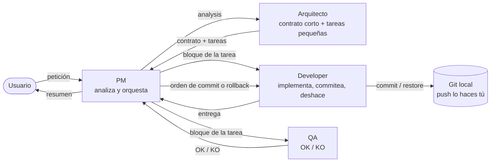
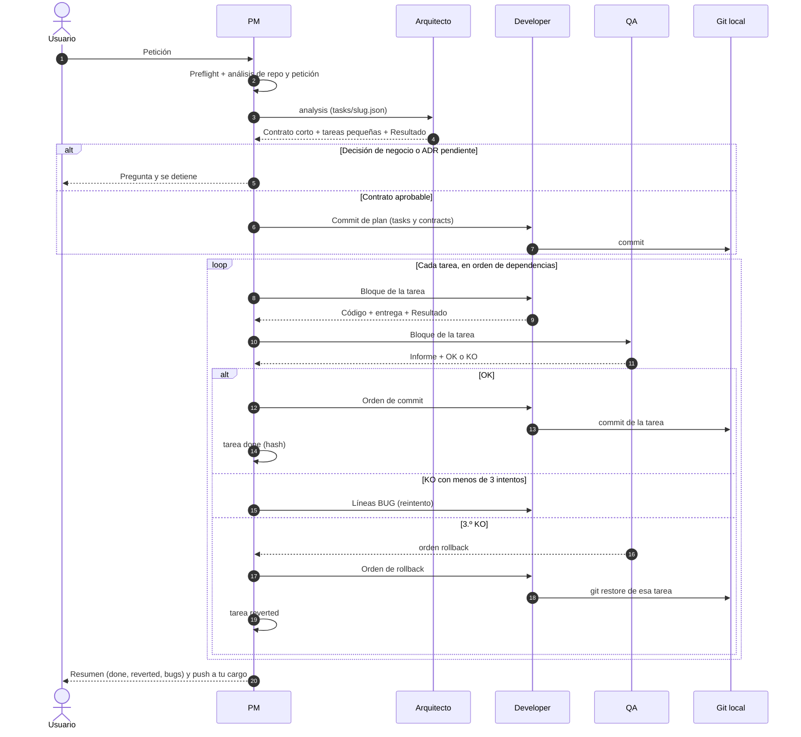
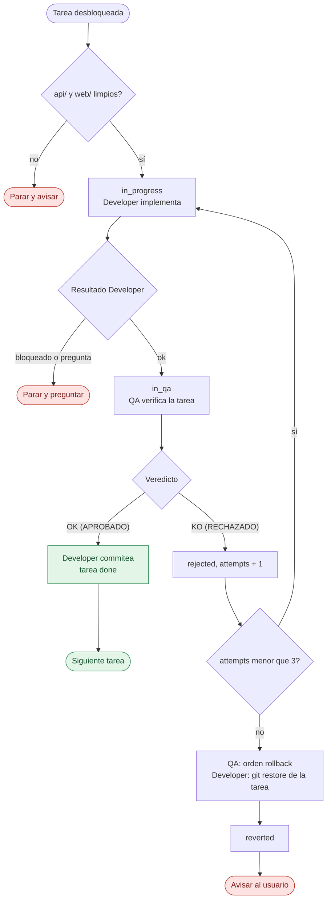
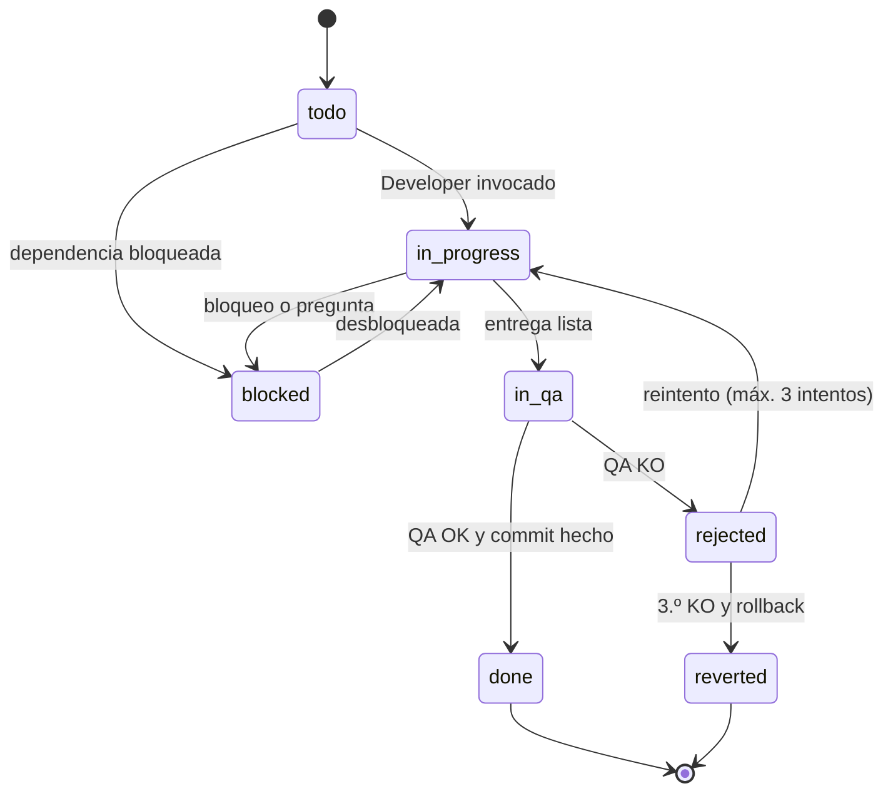

# Flujo de agentes · GrangesAndreu

Guía visual del circuito PM → Arquitecto → Developer → QA. Los diagramas usan Mermaid (para verlos en la vista previa de VS Code hace falta soporte de Mermaid). Las reglas completas están en [AGENTS.md](AGENTS.md) y en `.github/agents/`.

## 1. Visión general

El PM es el centro: analiza una vez, pasa el análisis al Arquitecto (que crea el contrato corto y las **tareas pequeñas**) y luego orquesta cada tarea con Developer y QA. Todo pasa por el PM. Solo el **Developer** escribe en git (commit de lo aprobado y rollback de lo rechazado 3 veces); nunca sube nada.

## 2. Secuencia de una petición

## 3. Bucle de una tarea

## 4. Estados de una tarea

## 5. Quién toca git

| Agente | Git |
|---|---|
| PM, Arquitecto, QA | Solo lectura (`status`, `diff`, `log`, `show`, `rev-parse`…) |
| Developer | Solo por orden del PM: `add`/`commit` de los ficheros de la tarea y `restore` de esos ficheros tras `orden: rollback` de QA |
| Todos | Nunca `push`, `pull`, `fetch`, `reset`, `clean`, `checkout`, `stash`, `revert`, `rebase`, `merge`, `--amend` ni ramas |

Como cada tarea aprobada queda commiteada, el árbol de `api/` y `web/` está limpio entre tareas y el `git restore` solo afecta a la tarea que falla.

## 6. Qué hace cada agente

| | PM | Arquitecto | Developer | QA |
|---|---|---|---|---|
| **Misión** | Analiza y orquesta | Contrato corto y tareas pequeñas | Implementa, commitea, deshace | OK o KO por tarea |
| **Entrada** | Petición | `analysis` del PM | Bloque de la tarea | Bloque de la tarea + entrega |
| **Salida** | `tasks/<slug>.json` (estado) | `contracts/<slug>.md`, ADR, `tasks` | Código, tests, `entrega-<ID>.md` | `qa-<ID>.md`, `BUG-NNN`, `orden` |
| **Edita `tasks/*.json`** | Estado (`status`, `attempts`, `bugs`, `commit`) y esqueleto | Solo añade `tasks` | No | No |
| **Git** | Lectura | Lectura | Commit y restore por orden | Lectura |

## 7. Ahorro de contexto

- Cada subagente recibe en el prompt **el bloque de su tarea** (id, `spec`, `files`, `acceptance`); no lee el JSON entero ni el contrato completo.
- Tareas pequeñas: ≤ 3 ficheros de producción, un objetivo, ≤ 5 criterios.
- Contrato corto (~15 KB) con lo compartido; los criterios viven en cada tarea.
- Developer y QA ejecutan solo los tests de la tarea; la regresión completa solo en `QA-*` y al cerrar la épica.
- Informes cortos: entrega ≤ 25 líneas, QA ≤ 1 página.

## 8. Cuándo se detiene el PM

| Situación | Qué hace el PM |
|-----------|----------------|
| Un agente devuelve `estado: pregunta` | Te pregunta y espera |
| Contrato con decisión de negocio o ADR pendiente | Te pregunta; el contrato sigue en `draft` |
| `api/` o `web/` con cambios ajenos | Para antes de empezar la tarea |
| 3 KO de una tarea | QA ordena el rollback, el Developer la deshace, la tarea queda `reverted` y avisa |
| Fichero fuera de alcance, o fallo de un commit o rollback | Para y avisa |

## 9. Cómo usarlo

1. Elige el agente **PM** en el selector de chat.
2. Describe lo que quieres. Añade "solo planifica" si no quieres que ejecute el circuito.
3. Antes del primer uso, deja `api/` y `web/` sin cambios pendientes (el flujo exige árbol limpio para poder hacer commit y rollback por tarea).
4. Al terminar, revisa `git log` y haz tú el `push`.
