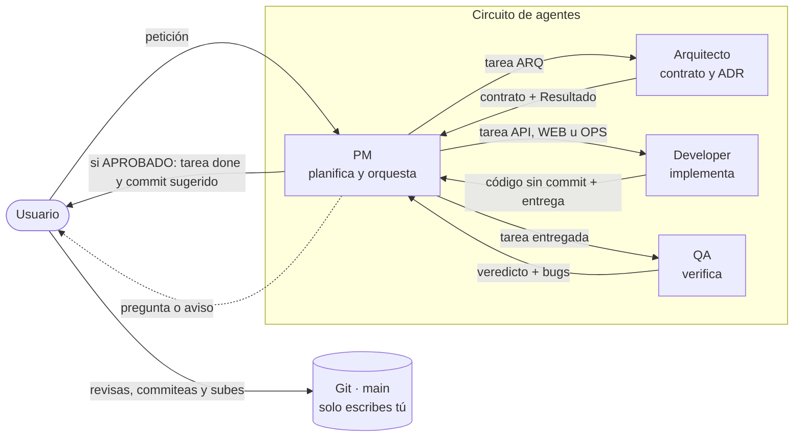
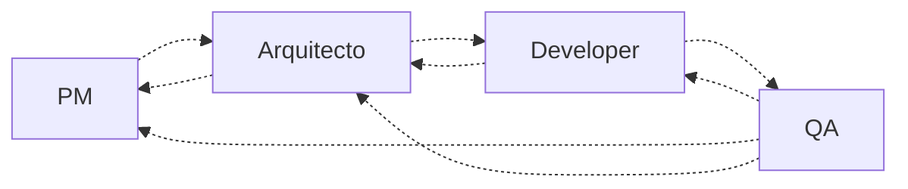
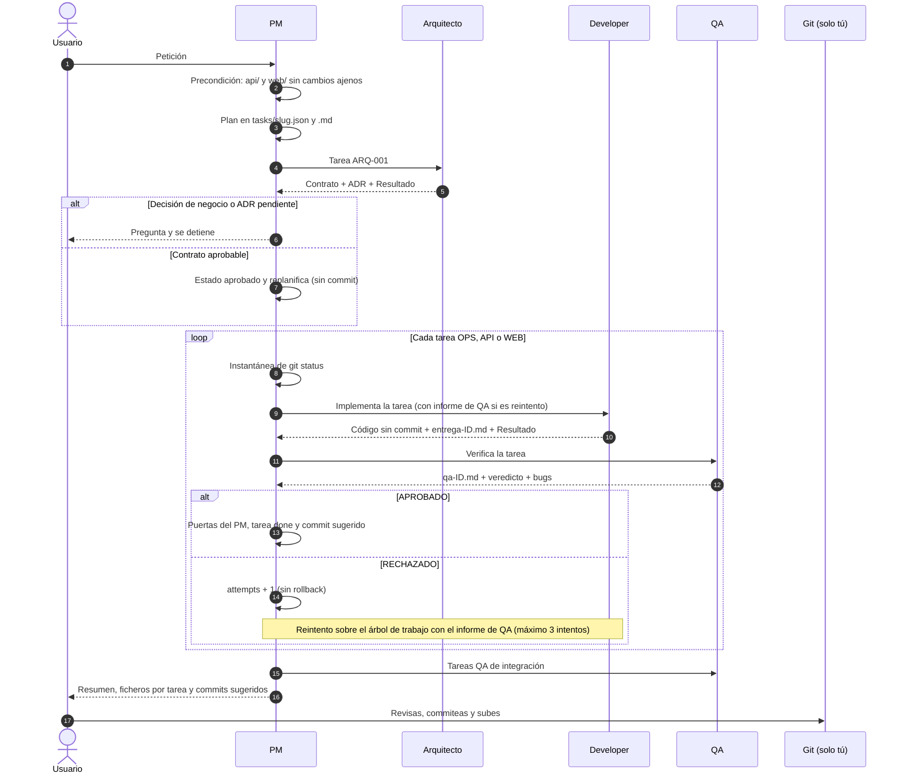
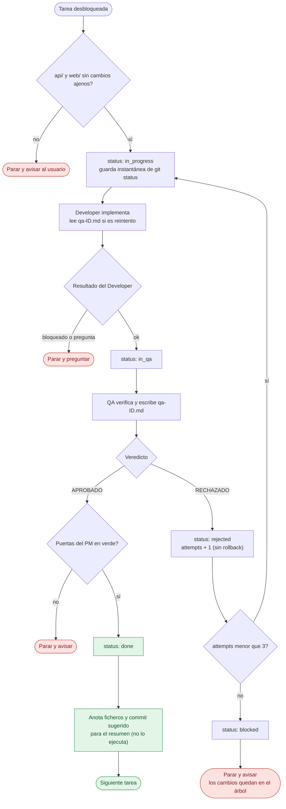
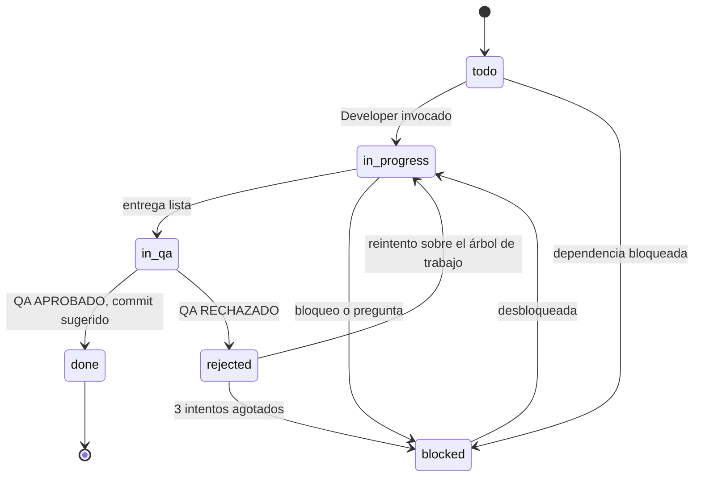
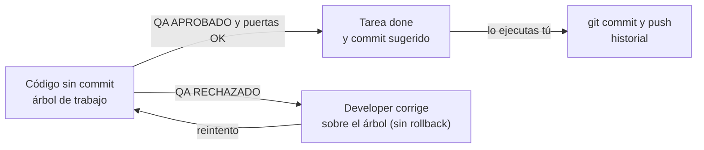
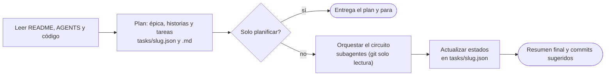
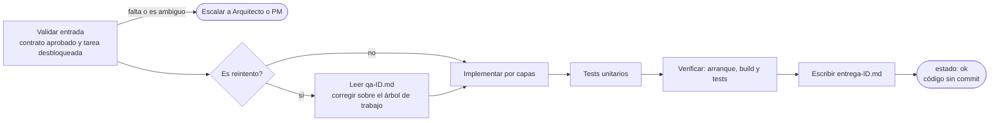
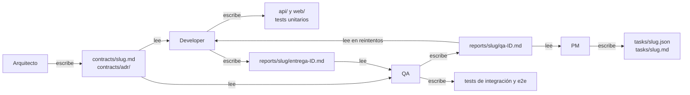

# Flujo de agentes · GrangesAndreu

Guía visual del circuito PM → Arquitecto → Developer → QA. Los diagramas usan Mermaid (para verlos en la vista previa de Markdown de VS Code hace falta soporte de Mermaid, p. ej. la extensión *Markdown Preview Mermaid Support*). Las reglas completas están en [AGENTS.md](AGENTS.md) y en `.github/agents/`.

## 1. Visión general

El PM es el centro del circuito: invoca a los demás como subagentes, recibe su bloque `## Resultado` y decide el siguiente paso. **Ningún agente hace commits ni subidas a git**: el código queda en el árbol de trabajo y los commits los haces tú con los mensajes que propone el PM.

Modo manual (sin orquestar): los *handoffs* de cada agente permiten pasar el trabajo a mano.

## 2. Secuencia de una petición completa

## 3. Bucle de una tarea (aprobación, reintento y paradas)

## 4. Estados de una tarea

## 5. Qué pasa con el código

Ningún agente hace commits ni subidas. Todo el código queda sin commit en el árbol de trabajo hasta que lo revisas y lo commiteas tú.

Para todos los agentes está prohibido cualquier `git` de escritura (`add`, `commit`, `push`, `pull`, `fetch`, `restore`, `clean`, `reset`, `revert`, `rebase`, `checkout`, `stash`…). Solo se permite git de lectura (`status`, `diff`, `log`, `show`, `rev-parse`).

## 6. Comportamiento interno de cada agente

### PM

### Arquitecto

### Developer

### QA

## 7. Ficha de cada agente

| | PM | Arquitecto | Developer | QA |
|---|---|---|---|---|
| **Misión** | Planifica, orquesta y propone el commit | Diseña el contrato antes de codificar | Implementa la tarea | Verifica con evidencia |
| **Entrada** | Petición del usuario | Tarea `ARQ-*` | Tarea `API/WEB/OPS-*` + contrato aprobado (+ `qa-ID.md` si reintento) | Entrega del Developer |
| **Salida** | `tasks/` y commits sugeridos (no ejecutados) | `contracts/<slug>.md`, `contracts/adr/` | Código, tests unitarios, `entrega-ID.md` | `qa-ID.md`, `BUG-NNN`, veredicto |
| **Herramientas** | read, search, edit, execute, todo, agent | read, search, edit, todo | read, search, edit, execute, todo | read, search, edit, execute, todo |
| **Git** | Solo lectura | No (sin terminal) | Solo lectura | Solo lectura |
| **Edita `tasks/*.json`** | Sí (único) | No | No | No |
| **No hace** | Código de producción ni contratos | Implementar ni planificar | Rediseñar contratos ni cambiar alcance | Corregir código ni instalar herramientas |

## 8. Ficheros que genera el circuito

## 9. Cuándo se detiene el PM

| Situación | Qué hace el PM |
|-----------|----------------|
| Un agente devuelve `estado: pregunta` | Te pregunta y espera |
| Contrato con decisión de negocio o ADR pendiente | Te pregunta; el contrato sigue en `draft` |
| `api/` o `web/` con cambios ajenos | Para antes de empezar la tarea |
| 3 intentos fallidos de una tarea | Marca `blocked`, deja los cambios en el árbol de trabajo y avisa |
| Puerta del PM en rojo o fichero fuera de alcance o prohibido | Para y avisa |

## 10. Cómo usarlo

1. Elige el agente **PM** en el selector de chat.
2. Describe lo que quieres. Añade "solo planifica" si no quieres que ejecute el circuito.
3. Antes del primer uso, deja `api/` y `web/` sin cambios ajenos pendientes (los de tareas ya aprobadas de la épica no cuentan).
4. Al terminar, revisa `git status` y ejecuta tú los commits sugeridos y la subida.
