# Flujo de agentes · GrangesAndreu

Guía visual del circuito PM → Arquitecto → Developer → QA. Los diagramas usan Mermaid (para verlos en la vista previa de Markdown de VS Code hace falta soporte de Mermaid, p. ej. la extensión *Markdown Preview Mermaid Support*). Las reglas completas están en [AGENTS.md](AGENTS.md) y en `.github/agents/`.

## 1. Visión general

El PM es el centro del circuito: invoca a los demás como subagentes, recibe su bloque `## Resultado` y decide el siguiente paso. Es el único que usa git de escritura.

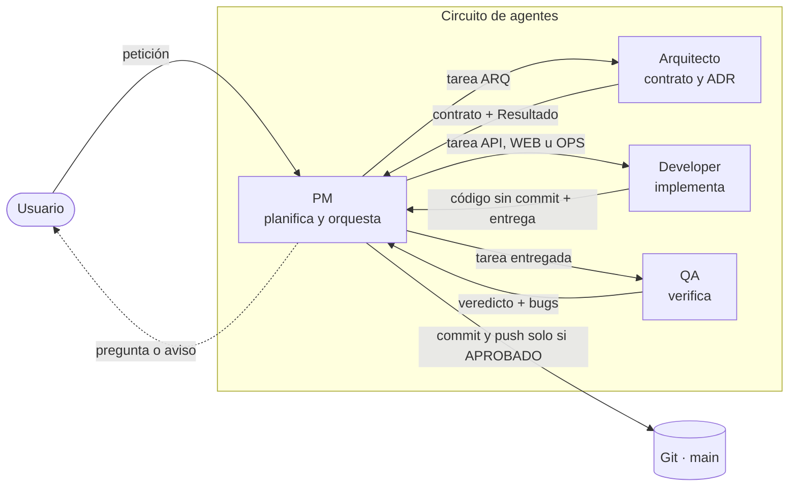

Modo manual (sin orquestar): los *handoffs* de cada agente permiten pasar el trabajo a mano.

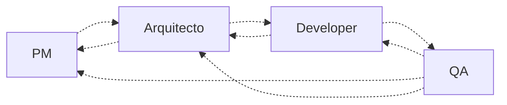

## 2. Secuencia de una petición completa

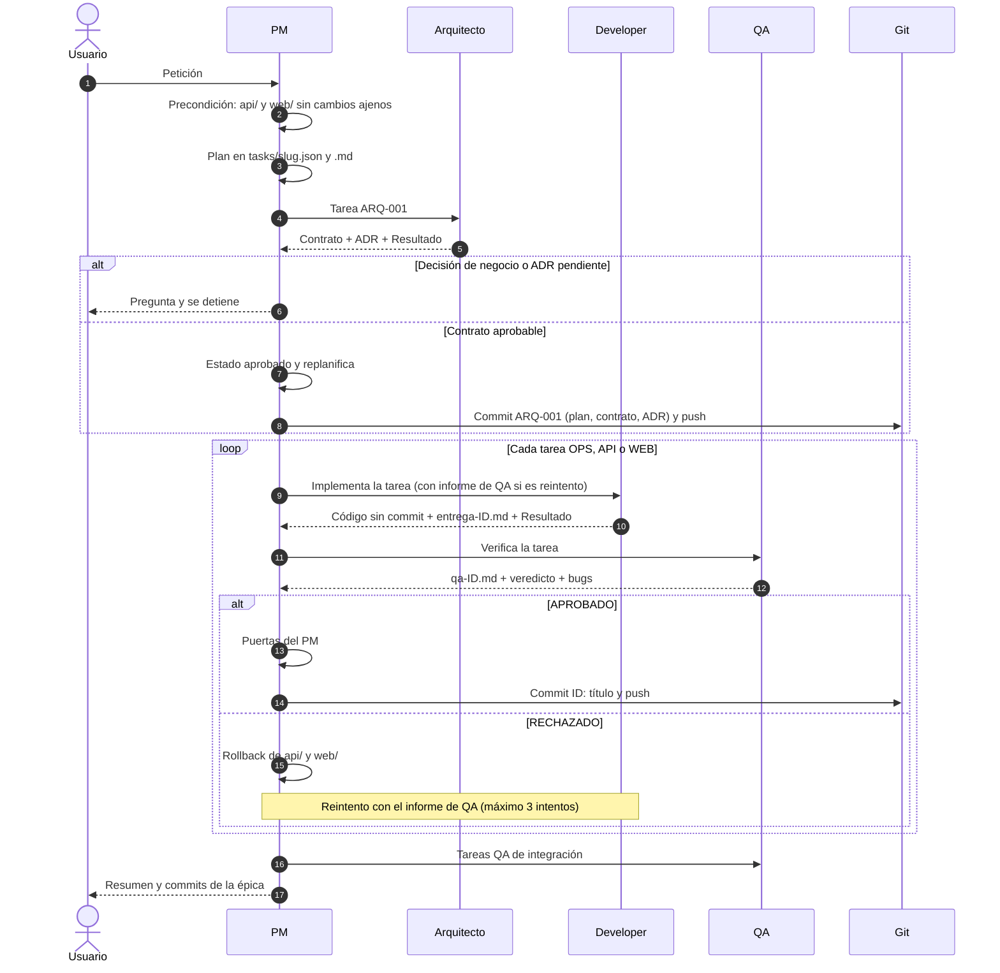

## 3. Bucle de una tarea (aprobación, rollback y paradas)

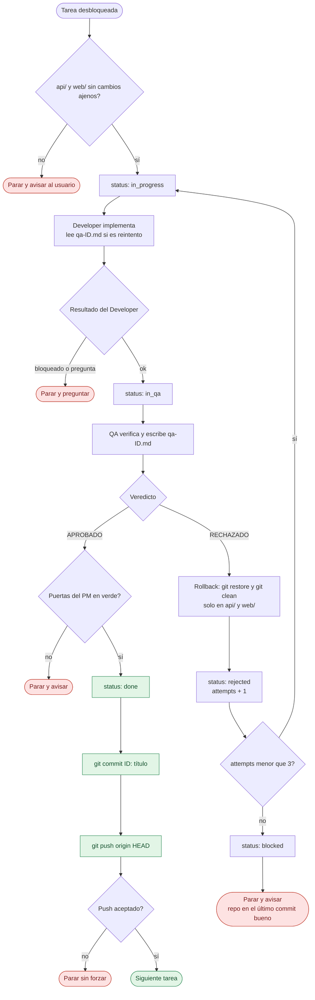

## 4. Estados de una tarea

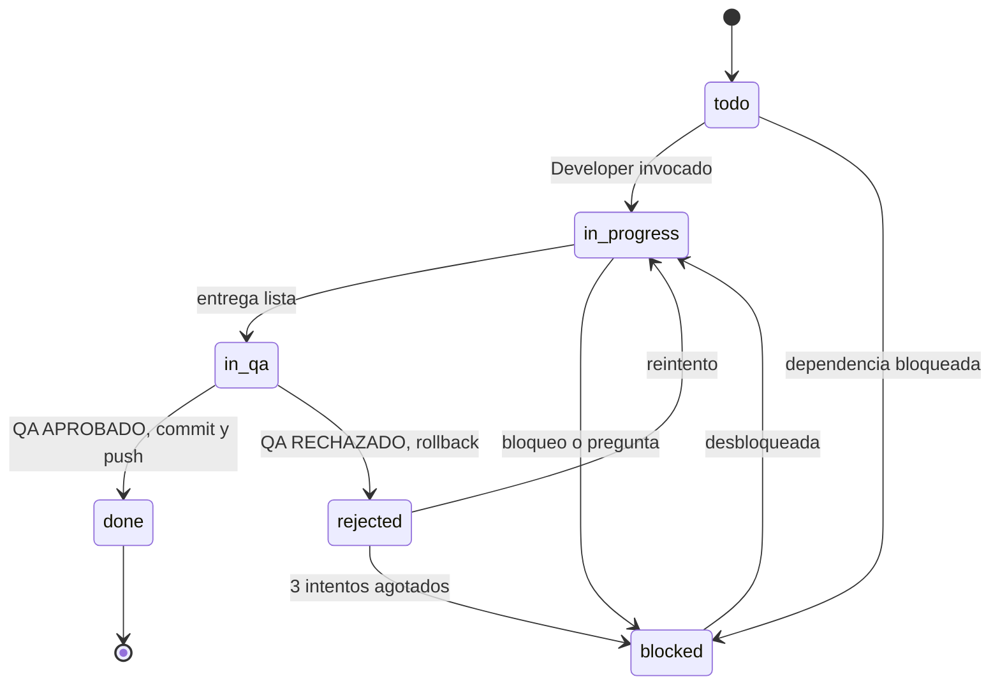

## 5. Qué pasa con el código

Nada entra en el historial sin aprobar. El código vive sin commit hasta que QA lo aprueba.

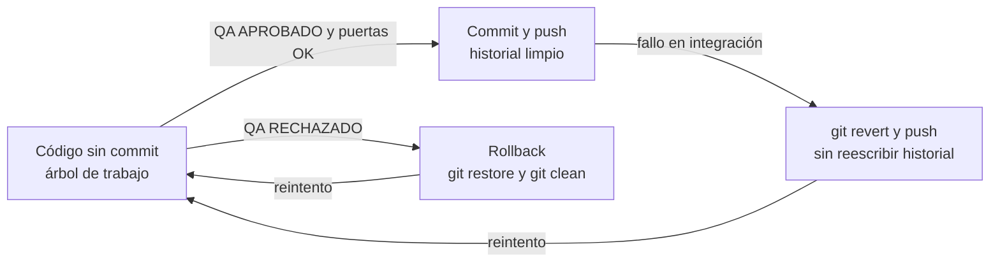

Prohibido para todos los agentes: `push --force`, `--no-verify`, `--amend`, `rebase`, `reset --hard`, `clean -x`. Developer y QA no usan git de escritura.

## 6. Comportamiento interno de cada agente

### PM
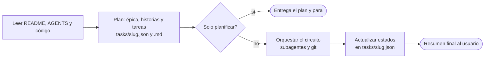

### Arquitecto
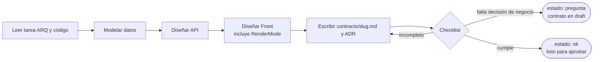

### Developer
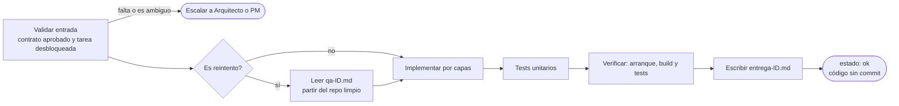

### QA
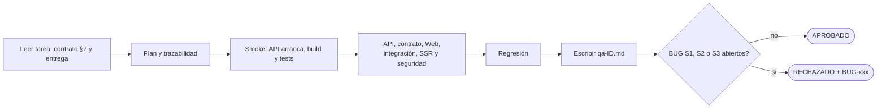

## 7. Ficha de cada agente

| | PM | Arquitecto | Developer | QA |
|---|---|---|---|---|
| **Misión** | Planifica, orquesta y cierra en git | Diseña el contrato antes de codificar | Implementa la tarea | Verifica con evidencia |
| **Entrada** | Petición del usuario | Tarea `ARQ-*` | Tarea `API/WEB/OPS-*` + contrato aprobado (+ `qa-ID.md` si reintento) | Entrega del Developer |
| **Salida** | `tasks/`, commits y push | `contracts/<slug>.md`, `contracts/adr/` | Código, tests unitarios, `entrega-ID.md` | `qa-ID.md`, `BUG-NNN`, veredicto |
| **Herramientas** | read, search, edit, execute, todo, agent | read, search, edit, todo | read, search, edit, execute, todo | read, search, edit, execute, todo |
| **Git** | Escribe (commit, push, rollback, revert) | No | Solo lectura | Solo lectura |
| **Edita `tasks/*.json`** | Sí (único) | No | No | No |
| **No hace** | Código de producción ni contratos | Implementar ni planificar | Rediseñar contratos ni cambiar alcance | Corregir código ni instalar herramientas |

## 8. Ficheros que genera el circuito

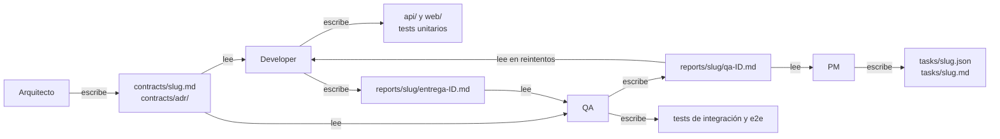

## 9. Cuándo se detiene el PM

| Situación | Qué hace el PM |
|-----------|----------------|
| Un agente devuelve `estado: pregunta` | Te pregunta y espera |
| Contrato con decisión de negocio o ADR pendiente | Te pregunta; el contrato sigue en `draft` |
| `api/` o `web/` con cambios ajenos | Para antes de empezar la tarea |
| 3 intentos fallidos de una tarea | Marca `blocked`, deja el repo en el último commit bueno y avisa |
| Puerta del PM en rojo o fichero prohibido en el diff | Para y avisa |
| `git push` rechazado | Para y avisa; no fuerza ni resuelve conflictos |

## 10. Cómo usarlo

1. Elige el agente **PM** en el selector de chat.
2. Describe lo que quieres. Añade "solo planifica" si no quieres que ejecute el circuito.
3. Antes del primer uso, deja `api/` y `web/` sin cambios pendientes en git.
4. Revisa los commits de la épica con `git log --oneline` cuando termine.
